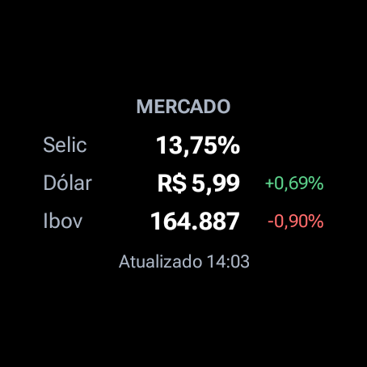
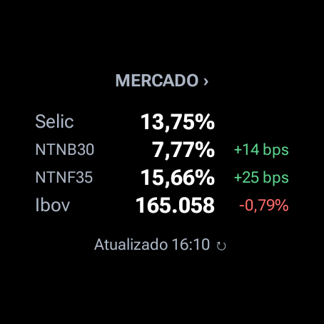
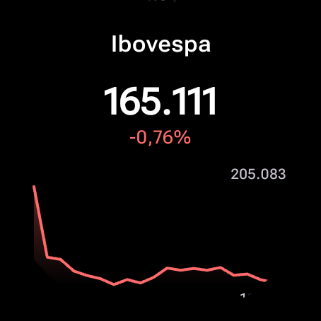
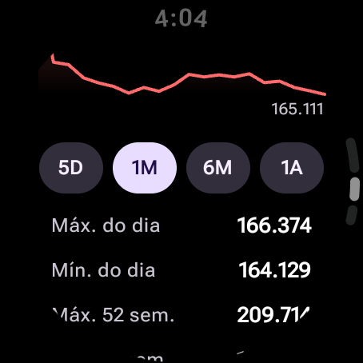
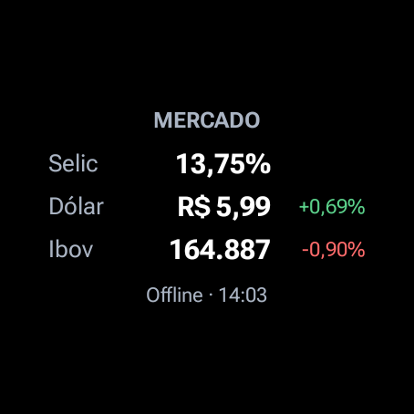

# MercadoWatch

Indicadores do mercado brasileiro no pulso: um **tile** e uma **complication** para Wear OS com Selic, dólar, Ibovespa, taxas de NTN-B/NTN-F e qualquer ticker que você quiser acompanhar, com gráfico e detalhes de cada ativo.

<p align="center">
  
  
  
</p>

## Funcionalidades

**Tile "Mercado"**
- Mostra de **1 a 6 ativos**, com valor e variação do dia (verde/vermelho). Nos títulos públicos, a variação é da taxa, em bps.
- Os ativos e a ordem são escolhidos pelo usuário. O padrão é Selic, dólar e Ibovespa.
- Atualiza sozinho a cada 30 minutos.
- Toques:
  - **numa linha** abre os detalhes daquele ativo;
  - **no rodapé** (`Atualizado 14:53 ↻`) atualiza na hora;
  - **em MERCADO ›** abre a tela de configuração.
- Sem internet, mostra os últimos valores salvos e indica `Offline · HH:mm`.

**Detalhes do ativo**
- Valor atual, variação do dia e **gráfico** com os períodos **5D, 1M, 6M e 1A**.
- Estatísticas conforme a fonte:
  - **Ações e índices:** máx./mín. do dia, faixa de 52 semanas, volume e bolsa.
  - **Moedas:** máx./mín. do dia, compra e venda.
  - **Séries do BCB:** data do último dado e máx./mín. no período.
  - **Títulos:** vencimento, taxas de compra e venda, PU e data de referência.
- Abre pelo tile ou por **Ver detalhes** na configuração. Offline, mostra o valor salvo e avisa que o gráfico precisa de conexão.

<p align="center">
  
  
  
</p>

**Complication "Selic meta"**
- Tipo `SHORT_TEXT`, título "Selic" e valor no formato brasileiro (ex.: `13,75%`).
- Atualiza a cada 1 hora, com o mesmo cache offline do tile.

**Configuração no relógio**
- Lista os ativos do tile, na ordem em que aparecem.
- **+ Adicionar ativo** inclui um novo no final, até o máximo de 6. O tile não rola: o layout se ajusta ao tamanho da tela e, com 5 ou 6 ativos, tira os espaçamentos para caber tudo dentro da borda redonda.
- Tocar num ativo abre as opções **Trocar ativo**, **Mover para cima/baixo** e **Remover do tile**. O último ativo não pode ser removido.
- Não há repetição: ao adicionar, os ativos que já estão no tile aparecem desabilitados; ao trocar, escolher um que já está em outra posição **troca os dois de lugar**.
- **Busca livre**: digite ou dite um nome ou ticker (`petr`, `dólar`, `hglg11`, `apple`…). A busca procura no catálogo e no Yahoo Finance, que cobre ações, FIIs, ETFs, índices, cripto e moedas.
- **Títulos públicos**: buscar `ntn` lista todos os vencimentos de NTN-B e NTN-F do arquivo mais recente da ANBIMA. Também filtra por título e ano: `ntnb`, `ntn-f`, `ntnb 2045`.

<p align="center">
  
  
</p>

## Catálogo e fontes de dados

| Fonte | Ativos | Observação |
|---|---|---|
| [Banco Central – SGS](https://dadosabertos.bcb.gov.br/) | Selic meta (432), CDI (4389), IPCA 12 meses (13522) | API oficial, sem chave |
| [ANBIMA – mercado secundário](https://www.anbima.com.br/pt_br/informar/taxas-de-titulos-publicos.htm) | NTN-B 2035, NTN-F 2035 e **qualquer vencimento** de NTN-B/NTN-F pela busca | Taxa indicativa diária; atraso de ~1 dia útil |
| [AwesomeAPI](https://docs.awesomeapi.com.br/) | Dólar, Euro, Bitcoin (em R$) | Cotação intradiária, sem chave |
| Yahoo Finance | Ibovespa, S&P 500, PETR4, VALE3, ITUB4, BBAS3, WEGE3 e **qualquer ticker** pela busca | Endpoints públicos **não oficiais** |

Nenhuma fonte exige chave de API.

## Requisitos

- Relógio ou emulador **Wear OS 3+** (API 30+). Testado no emulador Wear OS 6 (API 36) e num Galaxy Watch (SM-L715F, API 37).
- Android Studio com AGP 9.x / Kotlin 2.2 / JDK 17+ (o JBR do Android Studio serve).

## Como compilar e instalar

```bash
# Compilar
./gradlew :wear:assembleDebug

# Instalar (emulador ou relógio conectado ao adb)
adb install -r wear/build/outputs/apk/debug/wear-debug.apk
```

**Relógio pelo Wi-Fi**: no relógio, ative *Opções do desenvolvedor → Depuração por Wi-Fi → Parear novo dispositivo*, e então:

```bash
adb pair <IP>:<porta-de-pareamento> <código>
adb connect <IP>:<porta>   # em geral conecta sozinho após o pareamento
```

Depois de instalar:
- **Tile**: toque e segure nos tiles → **+** → **Mercado**.
- **Complication**: toque e segure no mostrador → **Personalizar** → escolha um espaço → **MercadoWatch → Selic meta**.
- **Ativos do tile**: abra o app **MercadoWatch** ou toque em **MERCADO ›** no tile.

## Estrutura do projeto

```
wear/src/main/java/com/example/mercadowatch/
├── complication/MainComplicationService.kt  # complication da Selic (SuspendingComplicationDataSourceService)
├── tile/MainTileService.kt                  # tile "Mercado" (ProtoLayout)
├── presentation/
│   ├── MainActivity.kt       # tela de configuração (Compose for Wear OS, Material 3)
│   ├── DetalhesActivity.kt   # detalhes do ativo: valor, gráfico por período e estatísticas
│   └── Grafico.kt            # gráfico de linha em Canvas (sem bibliotecas)
└── data/
    ├── Ativo.kt              # catálogo de ativos, fontes, formato e busca no catálogo
    ├── MercadoRepository.kt  # cotações, detalhes, busca de tickers/títulos e cache em SharedPreferences
    ├── Anbima.kt             # download e parse dos arquivos diários de títulos públicos da ANBIMA
    ├── Detalhes.kt           # modelos da tela de detalhes (período, pontos do gráfico)
    ├── Http.kt               # GET com HttpURLConnection
    ├── Preferencias.kt       # lista (1 a 6) e ordem dos ativos do tile
    └── Formatos.kt           # números no padrão brasileiro (13,75% · R$ 5,99 · 164.887)
```

O módulo `mobile/` é o app de celular do template e ainda não é usado.

**Adicionar um ativo ao catálogo**: inclua uma entrada em `Ativo.CATALOGO`, com id, rótulo curto, nome, fonte e formato. O `id` é usado como chave do cache e das preferências, então não deve mudar depois de publicado.

## Notas técnicas

- O endpoint `.../dados/ultimos/1` do SGS responde sempre **HTTP 304 sem corpo**. Por isso o app consulta um intervalo de datas que termina hoje. A série 432 também traz datas futuras (até a próxima reunião do Copom), e limitar `dataFinal` a hoje garante que o valor exibido é a meta em vigor.
- As requisições usam `HttpURLConnection` e `org.json`, sem bibliotecas de rede extras.
- Os endpoints do Yahoo Finance não são oficiais e podem mudar ou passar a bloquear as requisições. Se isso acontecer, o tile continua mostrando o último valor salvo, e a busca online deixa de trazer resultados (a busca no catálogo continua funcionando).
- A busca esconde as variantes da B3 que o Yahoo devolve junto (`PETR3F.SA`, `HGLG11Q.SA`) quando o ticker principal também aparece.
- **ANBIMA:** o endereço público (`.../merc-sec/arqs/ms{yyMMdd}.txt`) só mantém os arquivos dos **últimos ~5 dias úteis**; os mais antigos dão 404. Por isso o gráfico dos títulos tem só o período 5D. A variação do dia em bps compara os dois arquivos mais recentes. Fins de semana, feriados e o dia corrente antes da publicação também dão 404, e o app volta dia a dia até achar um arquivo.
- **P/L e outros indicadores fundamentalistas** ainda não aparecem nos detalhes. O endpoint do Yahoo que os fornece exige autenticação, e a alternativa (brapi.dev) precisa de um token.

## Aviso

Projeto pessoal, sem relação com o Banco Central, a ANBIMA, a B3, a AwesomeAPI ou o Yahoo. As cotações podem ter atraso e **não devem ser usadas como base para decisões de investimento**.

## Licença

[MIT](LICENSE)
